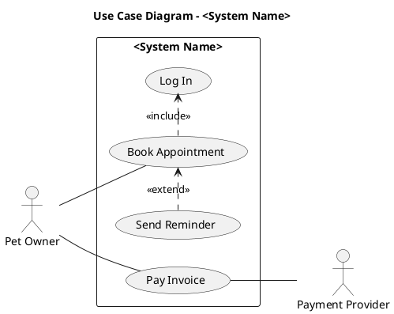
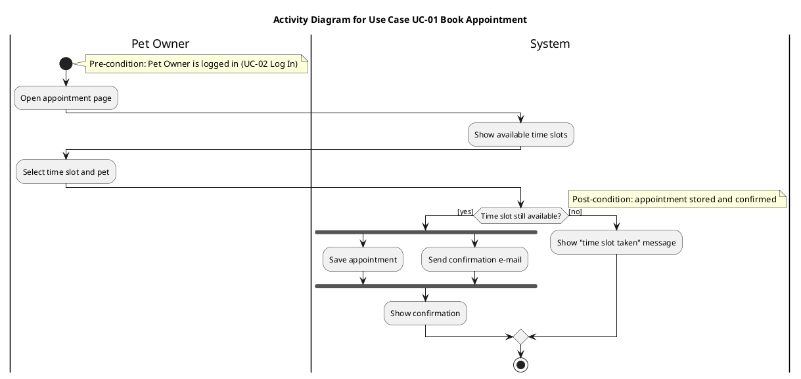
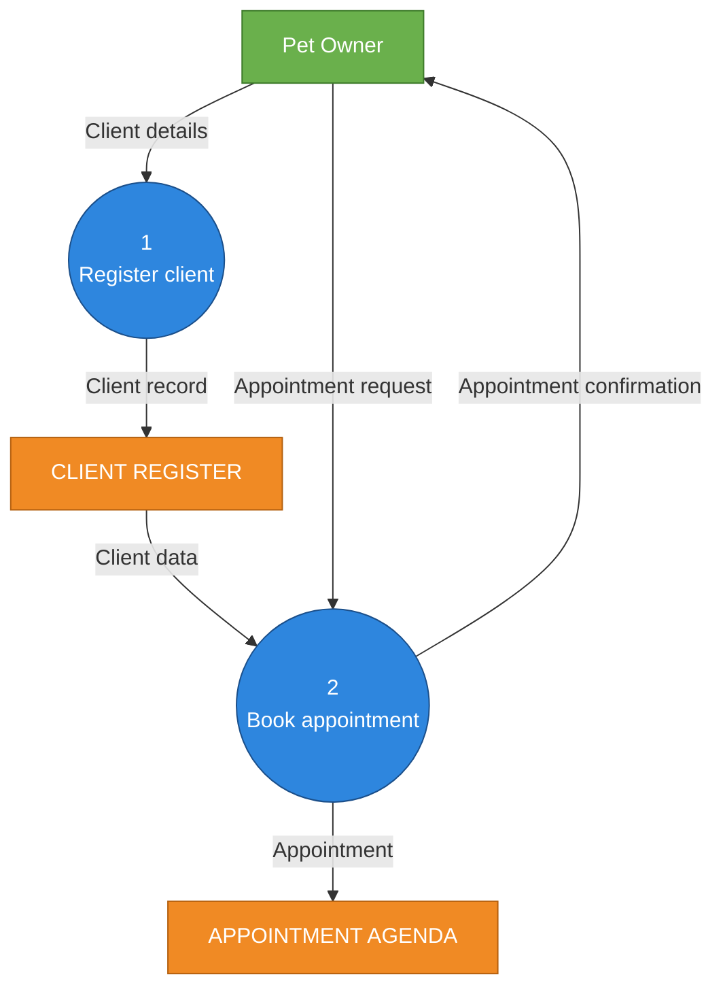
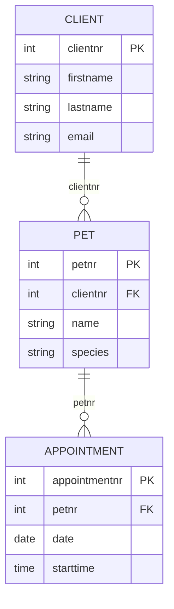
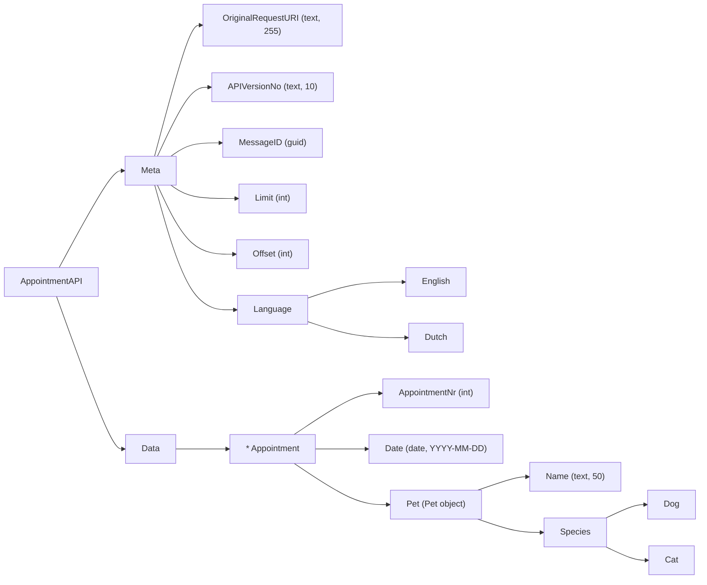
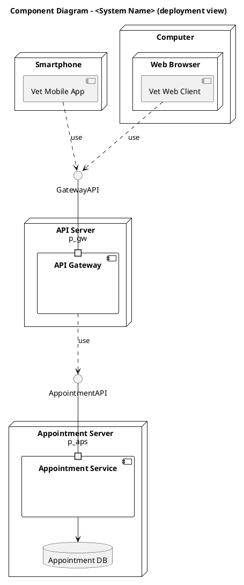

# FDS Builder (HZ Semester 3 – Functional Design Specifications)

You produce a complete FDS for the project/case in this repository, in ONE pass, where every
artifact traces back to the requirements and every artifact agrees with every other artifact.
The course grades on two things above all: **following the course notation conventions** and
**alignment** (requirements ↔ UCD ↔ UC specs ↔ activity diagrams ↔ DFDs ↔ ERD ↔ API messages ↔
component diagram). Optimise for both.

---

## 0. Inputs, language and assumptions

1. Find the case/project description. Look for (in this order): files the user mentioned,
   `case*.md`, `brief*`, `project*`, `docs/**`, `*.pdf`, `*.docx`, `README.md`. Read all of it.
2. If there is no case description at all, ask the user ONCE for it and stop. Otherwise do NOT
   stop to ask questions: make reasonable, realistic assumptions ("use some imagination", as the
   course says) and log every assumption in the `Assumptions` section of the FDS (A-01, A-02 …).
3. Write the FDS in **English** (course language) unless the user explicitly asks for Dutch.
   Keep the course terminology exactly as listed in this file.
4. Check for an existing `docs/fds/` folder. If it exists, update it instead of starting over.

## 1. Output layout

```
docs/fds/
  FDS.md                     # the full document (main deliverable)
  registry.yaml              # single source of truth for all IDs (build this FIRST)
  requirements.csv           # full requirements list (Excel-openable)
  diagrams/src/*.puml        # PlantUML sources: UCD, activity, component
  diagrams/src/*.mmd         # Mermaid sources: DFD, ERD, data object trees
  diagrams/*.svg             # rendered diagrams (embedded in FDS.md)
  api/<ApiName>-spec.md      # one API specification per microservice API
  api/<ApiName>-response.json
```

Mermaid diagrams are ALSO embedded inline in `FDS.md` as ```mermaid blocks (GitHub renders them).
PlantUML diagrams are embedded as rendered SVG images (GitHub does not render PlantUML).

## 2. Work order (do not skip, do not reorder)

1. **Registry first.** Create `registry.yaml` with all IDs before drawing anything:
   stakeholders, actors, requirements (BR/UR/FR/NFR/PR), use cases (UC), activity diagrams (AD),
   DFD processes (P1, P1.1 …), data stores, entities, microservices, APIs, components.
   Every later artifact may ONLY use names/IDs from the registry. If you need a new one, add it to
   the registry first. Names must be spelled identically everywhere.
2. Introduction, business/domain context, stakeholders.
3. Requirements (pyramid) → `requirements.csv` + tables in FDS.md.
4. Use Case Diagram + UC list.
5. Use Case Specifications.
6. Activity Diagrams.
7. DFD level 0, level 1, level 2.
8. Written 3NF relations → ERD → Logical Data Dictionary.
9. Functional grouping into microservices.
10. Logical Data Object Trees → JSON response examples → API specifications.
11. Component Diagram (deployment-view microservices architecture).
12. Acceptance criteria, constraints & limitations, assumptions, glossary.
13. Traceability matrix.
14. Render all diagrams, run the self-check (section 14), fix everything, re-render.

## 3. Minimum scope (scale up for bigger cases)

| Artifact | Minimum |
|---|---|
| System requirements | Covering the whole case; ~20–40 FRs + ≥8 NFRs for a typical project |
| UCD | One full UCD of the whole system |
| UC specifications | Every "Must" use case (never fewer than 2) |
| Activity diagrams | One per specified "Must" UC (never fewer than 2) |
| DFD | Level 0 (whole system), Level 1 (whole system), Level 2 for ≥1 (ideally 2) complex level-1 processes |
| ERD | Whole business domain, 3NF |
| Logical Data Dictionary | Every attribute of every entity |
| Logical Data Object + JSON + API spec | Every microservice API (never fewer than 2) |
| Component diagram | Whole system, deployment view |

---

## 4. Introduction & stakeholders

- Purpose and scope of the system, what is out of scope.
- Business/domain context: the organisation, the problem, the current situation (IST) and desired
  situation (SOLL) in prose.
- Stakeholder table: Stakeholder | Role/interest | Influence | Represented by actor(s).
  Stakeholders include people AND external organisations/systems AND IT Operations/support.

## 5. Requirements (Requirements Pyramid)

Levels and ID prefixes:

| Level | Prefix | Content |
|---|---|---|
| Business requirement | BR-xx | High-level business purpose/process the system must support |
| User requirement | UR-xx | What each user role needs (the *what*, never the *how*) |
| System requirement – functional | FR-xx | What the system must do: inputs/outputs, processing, error handling |
| System requirement – non-functional | NFR-xx | Quality attributes & constraints, system-wide |
| Project requirement | PR-xx | Timelines, budget, organisation, documentation, governance |

Rules:
- Traceability: every UR has a parent BR, every FR has a parent UR. Business and user requirements
  boil down to system requirements – **the FR + NFR list is the final list**.
- System requirements are written as **"The system SHALL …"** (or "The <subsystem> SHALL …").
- User requirements: "The <Actor> needs to be able to …" – no solution/technology words.
- Every requirement gets a MoSCoW priority (Must/Should/Could/Won't), business-led.
- Every requirement must satisfy the 8 quality criteria: Atomic, Complete, Correct, Feasible,
  Necessary, Prioritized, Unambiguous, Verifiable. NFRs must be measurable
  ("within 0.5 seconds", "99.5 % availability per month"), never "fast" or "user-friendly".
- NFR categories (tag each NFR): Performance, Scalability, Availability/Reliability, Security,
  Privacy/Legal, Usability/UX (incl. interface languages), Compatibility, Maintainability,
  Operational (logging, monitoring), Technical constraint (technology/architecture to be used).
  **"Microservice architecture" is an NFR (technical constraint)**, as are languages/frameworks.
- Classification pitfalls: a go-live date = Project requirement; "built in Python" = NFR
  (technical constraint); a refresh rate = NFR (performance); "scale to millions of users" = NFR
  (scalability); "check outstanding loans before granting a mortgage" = functional (business).
- No user stories. Use cases ≠ user stories ≠ requirements.

`requirements.csv` columns:
`ID,Level,Description,Parent ID,Stakeholder/Actor,MoSCoW,NFR Category,Related UC,Verification Method`

## 6. Use Case Diagram (UCD) – PlantUML

Conventions (strict):
- **Actors**: unique, singular, simple nouns in Title Case. They are sources/destinations of
  data: people/roles, external systems, hardware, time triggers ("Time"), event triggers, admin
  roles. Every actor has **at least one association**.
- **Use cases**: active verb + noun, Title Case, succinct, unique ("Book Appointment",
  "Log In", "Register Client"). Every base UC is associated with at least one actor.
- **Association**: a single solid line, **no arrowhead**.
- **<<include>>**: dashed arrow **from the base UC to the included UC**. Used when ≥2 UCs share
  mandatory common behaviour; the included UC cannot be used on its own.
- **<<extend>>**: dashed arrow **from the extending UC to the base UC**. Optional/conditional
  behaviour; the base UC is complete without it.
- include/extend are between UCs only, never to actors.
- System boundary rectangle with the system name.
- NO actor or UC generalisation (inheritance). NO NFRs, project requirements or user stories on
  the UCD.
- Layout: primary actors left, secondary/external actors right; avoid crossing lines
  ("spaghetti") – group and order UCs to keep it legible.

Template:


Also add a UC list table: UC ID | Name | Actor(s) | Priority | Related FRs.

## 7. Use Case Specifications

One table per UC, using exactly these rows:

| Field | Content |
|---|---|
| Use Case Specification | UC-xx (unique) |
| Use Case Name | Same name as on the UCD |
| Actor(s) | Primary and secondary actors (must match UCD associations) |
| Summary Description | 1–3 sentences: the actor's goal |
| Priority | MoSCoW (matches requirements) |
| Status | e.g. Draft / Medium level of detail |
| Pre-Condition(s) | What must be true before start (can reference another UC's post-condition) |
| Post-Condition(s) | What is true after successful completion |
| Basic Path | Numbered steps 1, 2, 3 … alternating actor action / system response, goal → fulfilled |
| Alternative Paths | Numbered from the step they branch from (3a, 3b …). **Only successful alternative completions** |
| Exception Paths | E1, E2 … error handling (invalid input, service unavailable, unauthorised …) with the step they branch from |
| Business Rules | BR1, BR2 … domain rules/constraints that apply |
| Non-Functional Requirements | References NFR-xx with a short description |
| Related Requirements | FR-xx list (traceability) |

Pitfall: "invalid password", "username unknown", "website unavailable" are **Exception Paths**,
not Alternative Paths. Write every UC spec with exception paths where errors are possible.

## 8. Activity Diagrams – PlantUML (activity beta syntax)

- One AD per specified UC. Title: **"Activity Diagram for Use Case UC-xx <Name>"**.
- Steps MUST match the UC spec: basic path, alternative paths AND exception paths all appear.
- Swimlanes = the actors involved in this UC, plus a **System** lane. Not all actors of the
  system – only those in this UC.
- Show the connection to boundary UCs (e.g. a note or action "→ continues in UC-05 Pay Invoice";
  pre-condition from a previous UC's post-condition).
- Allowed elements ONLY (course convention): initial node (with a pre-condition note), action /
  system step (rounded rectangle), control flow arrows, decision node with **guards in [ ]**,
  merge node (paired with a decision), fork + join bars (always paired) for concurrent steps,
  activity final node (with a post-condition note). Do NOT use other UML activity symbols
  (signals, flow-final, object nodes, expansion regions, etc.).
- Action names: short verb phrases. Add a question text to decision nodes if it helps clarity.

Template:


## 9. Data Flow Diagrams – Mermaid

Notation (advised Semester 3 convention – use these colours):
- **Activity/process**: blue circle, number + unique name in verb-infinitive form
  ("1 Register client"). Numbered top-to-bottom in flow sequence.
- **Information collection/store**: orange rectangle, unique name in CAPITALS
  ("CLIENT REGISTER"). Not necessarily a database (spreadsheet, e-mail, ledger, API …).
- **Source/destination (external entity)**: green rectangle, unique singular noun = the UCD
  actors.
- **Information flow**: arrow with a **noun** label (the data!), never a verb. Arrow out of a store
  = data consulted; arrow into a store = data stored/updated.

Levels:
- **DFD-0 (Context Diagram)**: exactly ONE process circle (the whole system), all external
  entities, all in/outgoing data flows. No stores.
- **DFD-1**: the system decomposed into main processes (1, 2, 3 …), main data stores, external
  entities. Whole system in one diagram.
- **DFD-2**: one level-1 process decomposed (2.1, 2.2 …). Title it ("DFD Level 2 – Process 2
  Manage Appointments"). Level 2 is the deepest level required – never make level 3.

Steps: define activities and number them → define stores → arrows activity↔store → define
sources/destinations → arrows with concrete noun names → arrows between directly-following
activities only.

Consistency: external entities = UCD actors; processes ↔ UCs / AD actions; stores ↔ ERD
entities (or groups of entities); every flow's data appears as attributes in the ERD.

Template:


## 10. Data model – 3NF, ERD, Logical Data Dictionary

1. **Noun–verb analysis** of requirements, UC specs, ADs and DFD flows: nouns = data, verbs =
   behaviour/business rules. Look especially at flows between swimlanes and DFD flows.
2. **Write out the relations in 3NF first** (in FDS.md), primary key underlined/marked:
   `APPOINTMENT (appointmentnr, date, time, petnr, vetnr)`.
   Check 1NF (atomic values, no repeating groups, e.g. split address into street, housenumber,
   postcode, city, country), 2NF (no partial dependency on part of a composite key), 3NF (no
   transitive dependency between non-key attributes).
3. **Think about keys.** Do not blindly add an artificial `id` column: a composite key encodes a
   business constraint (e.g. CONTRACT(room#, contract_date, …) prevents double booking of a room on
   one day). If you choose a surrogate key, add a business rule / unique constraint that keeps the
   constraint and state it.
4. **ERD** in crow's foot notation (exam notation). Entities only – **no data stores, no
   processes**. Label each relationship with the PK/FK attribute name. The "many" side is away
   from the entity that owns the primary key. Cardinalities must reflect the business rules in the
   UC specs.



5. **Logical Data Dictionary** (logical level, not physical DB types). Table columns:
   Entity | Attribute | Description (what it represents in the domain) | Logical type (Text,
   Integer, Decimal, Money, Date, Time, DateTime, Yes/No, Hyperlink, Image, BLOB, JSON) |
   Length/format (e.g. text 50, YYYY-MM-DD, EUR 2 decimals) | Unit | Data nature (nominal /
   ordinal / discrete / continuous / absolute / relative %) | Allowed values or range |
   Mandatory/Optional | Key (PK/FK).

## 11. Functional grouping into microservices

- Group functionally related UCs + their entities into business-domain microservices
  (e.g. Client Service, Appointment Service, Billing Service). Table:
  Microservice | API name | UCs | Entities owned | FRs.
- Each entity is owned by exactly one service. Describe how referential integrity across services
  is kept (IDs referenced across services, validation via the owning API, orchestration in the
  API Gateway/service).
- State that microservices are an NFR (link the NFR ID).

## 12. API message design (per microservice API)

For every API, follow the course's 5 steps:

1. Domain-wide ERD (done in section 10) → choose the part owned by this API.
2. Define the data object hierarchy and categories (nominal data such as Species, Status,
   Genre become enumerated categories).
3. Logical Data Object names, attribute names and logical types; drill down; mark every
   **collection with `*`**; note max text length (useful for performance NFRs). Refer to the
   Logical Data Dictionary for details.
4. Add a **Meta** node, separate from the **Data** (payload) node.
   Meta candidates (justify each by FR/NFR): OriginalRequestURI, APIVersionNo, MessageID,
   Limit, Offset (pagination), Language (localisation), DataSize, EventType, security
   credentials (standard, version). Errors: handled by HTTP status codes (mention, don't model).
5. Draft a JSON response example for a **GET (all)** with realistic dummy data. Focus on the
   response.

Logical Data Object Tree template (root = unique API name):


JSON response template – **must be valid JSON** (validate with `python -m json.tool`; note the
slide example wraps an array in `{ }`, which is invalid – use `"Data": [ … ]`):
```json
{
  "AppointmentAPI": {
    "Meta": {
      "OriginalRequestURI": "https://api.example-vet.nl/appointments?limit=2&offset=0",
      "APIVersionNo": "1.0",
      "MessageID": "3f1c2a9e-7b4d-4c1a-9e2f-8a6b5d4c3e21",
      "Limit": 2,
      "Offset": 0,
      "Language": "English"
    },
    "Data": [
      { "AppointmentNr": 1021, "Date": "2026-11-03", "StartTime": "09:30",
        "Pet": { "Name": "Bello", "Species": "Dog" } }
    ]
  }
}
```

Discuss performance briefly per API: size (pagination, filters such as date ranges, no large
images inline), latency (one aggregated response vs many small requests – where is the business
logic/orchestration?).

**API specification** (`api/<ApiName>-spec.md`, also summarised in FDS.md), sections:
1. About / What is it – purpose, who can use it, what it can do, version history, current version.
2. Resources – supported UCs/FRs, resources and endpoints (method + URI + description),
   Logical Data Object Tree, limits (paging/throttling).
3. How can it be accessed – base URI, authentication & authorisation, how to obtain a key.
4. Example messages – example request(s) and the JSON response(s) with dummy data.
5. Code snippets – optional, not required for Semester 3 (omit unless asked).

DTOs: add a short section explaining that each Logical Data Object will be realised as a DTO
(serialisation/deserialisation, Meta + Payload, optional integrity methods) with pros
(decoupling, fewer calls, no internal structure exposed) and cons (extra mapping code,
duplication, versioning effort). DTOs are not implemented in the Semester 3 project.

## 13. Component Diagram – PlantUML (deployment view)

Expected style: the "microservices system level" example – devices/servers as nodes, components
inside them, and every service exposing a **uniquely named API interface** (never just
"REST API").
- Client side: Web Browser (web client) and/or Smartphone (mobile app) nodes.
- **API Gateway** node/component that the clients call.
- One node per microservice with its «component» service and its own database.
- **Ports** (small squares) on component edges where the interface is exposed = the API
  endpoints.
- Provided interface = lollipop with the API name (AppointmentAPI); required interface/usage =
  dependency (dashed arrow) or socket from the consumer.
- Optionally runtime environment (e.g. Node.js/Express) as a note or nested node.
- External systems (payment provider, e-mail service) as separate components/nodes, matching
  UCD actors.

Template:

If a PlantUML construct fails to render on the installed version, simplify the syntax (e.g. drop
`portin` and attach the interface directly) – but keep named interfaces.

## 14. Remaining FDS sections

- **Acceptance criteria**: per Must UC, testable criteria (Given/When/Then or a numbered list)
  linked to FR/NFR IDs.
- **Constraints & limitations**: link to NFRs and PRs.
- **Assumptions**: A-xx list (everything you invented).
- **Glossary**: domain terms.
- **Traceability matrix**: one row per FR: FR | Parent UR | BR | UC | AD | DFD process | Entities |
  API/endpoint | Component.

## 15. Rendering

1. PlantUML: use `plantuml -tsvg` if installed; else `java -jar plantuml.jar -tsvg` if a jar is
   available; else, if network is allowed, `npx -y node-plantuml` or the PlantUML server. Output to
   `docs/fds/diagrams/`.
2. Mermaid: `npx -y @mermaid-js/mermaid-cli -i file.mmd -o file.svg` (also keep inline blocks in
   FDS.md).
3. If rendering is impossible, keep the sources, tell the user exactly which command to run, and
   still embed Mermaid inline.
4. Fix every render error. Open/inspect each SVG size > 0.
5. Optional, only if `pandoc` exists and the user wants it: export `FDS.md` to `FDS.docx`/PDF.

## 16. Self-check (do this before finishing, fix and re-render)

Requirements
- [ ] Every UR → BR, every FR → UR; IDs unique; all have MoSCoW; FRs use "SHALL".
- [ ] Every NFR is measurable and categorised; microservices/tech choices are NFRs; dates/budget are PRs.

UCD & UC specs
- [ ] Every actor has ≥1 association; associations have no arrowheads.
- [ ] UC names: verb + noun, Title Case, unique; actor names: singular nouns, Title Case.
- [ ] include arrow points base → included; extend arrow points extension → base; no actor links on include/extend.
- [ ] No generalisation, no NFRs/PRs on the UCD, system boundary present, no crossing lines where avoidable.
- [ ] Every UC spec name/actors/priority match the UCD and requirements.
- [ ] Errors are Exception Paths, not Alternative Paths.

Activity diagrams
- [ ] One per specified UC, titled "Activity Diagram for Use Case …".
- [ ] All basic/alternative/exception steps from the UC spec are present, same wording.
- [ ] Guards in [ ]; every decision has a merge; every fork has a join; only course symbols used.
- [ ] Swimlanes only for actors in that UC + System; pre/post-condition notes present.

DFDs
- [ ] DFD-0 has exactly one process; no level 3.
- [ ] Flow labels are nouns; processes numbered and verb-infinitive; stores in CAPITALS; colours per convention.
- [ ] External entities = UCD actors; processes map to UCs; stores map to ERD entities.

Data
- [ ] Relations written in 3NF with keys; composite vs surrogate key decision justified.
- [ ] ERD in crow's foot, relationships labelled with key names, no stores/processes.
- [ ] Every ERD attribute is in the Logical Data Dictionary, and every DFD flow's data exists in the ERD.

API & architecture
- [ ] Every entity owned by exactly one microservice; every microservice has a unique API name.
- [ ] Data object trees: root = API name, Meta separate from Data, collections marked `*`, types and lengths given.
- [ ] Every JSON file passes `python -m json.tool`; attribute names match the tree and dictionary.
- [ ] Every API spec has sections 1–4.
- [ ] Component diagram: API Gateway, ports, uniquely named interfaces (no generic "REST API"), one DB per service, external systems match UCD actors.

Overall
- [ ] Every name in every artifact exists in `registry.yaml` with identical spelling.
- [ ] Traceability matrix complete, no FR without a UC (except pure NFR-driven ones, which are explained).
- [ ] All assumptions logged.

Finish with a short summary to the user: what was produced, the list of assumptions they should
verify with the case owner/teacher, and any diagram that could not be rendered.
