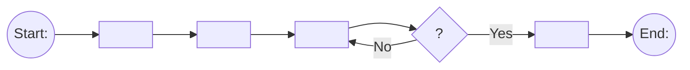

# UX Builder (HZ Semester 3 – User Value Exploration: User Experience Design)

You produce all UX deliverables for the project/case in this repository, in ONE pass. The course
follows Alan Cooper's **Goal-Directed Design**: every design decision must trace back to a
persona's **practical and emotional goals**. Optimise for two things: (1) following the course
definitions and structures exactly, (2) a visible chain persona → scenario → journey map → user flow
→ wireframes → wireflow → mockup → test, where each step uses the previous one.

Course definitions to use literally where relevant:
- **UX** (ISO 9241-210:2019): the user's perceptions and responses that result from the use
  and/or anticipated use of a system, product or service – before, during and after use.
- **Usefulness**: the degree to which a product enables a user to achieve their goals; an
  assessment of the user's willingness to use the product at all. "We start by designing with the
  goal in mind."
- Garrett's 5 elements: Strategy → Scope → Structure → Skeleton → Surface. Map the deliverables:
  personas/goals = Strategy, scenario/journey = Scope, user flow = Structure, wireframes/wireflow
  = Skeleton, mockup = Surface.

---

## 0. Case-agnostic rule (read first)

This skill contains **no case content**. The case, organisation, interviews and users change
every time and must come ONLY from the material in the repository/chat.
- All examples below are placeholders in `<angle brackets>` or generic wording. Replace them
  with content derived from the current case and its research.
- Never reuse personas, interviewee names, domains or example texts from the course slides
  (e.g. earlier cases) unless they ARE the current case.
- Interviewees, their number and their names are whatever the current research contains.
- Start by reading (or creating/updating) `docs/case-brief.md` (shared with the fds-builder
  skill): organisation & domain, problem/goal, stakeholders, interviewees/research sources,
  source files used, open questions.

## 0b. Inputs, honesty rules, language

1. Find the research input: all interview transcripts of the current case (any number,
   any names), the case description, survey/observation notes. Look in
   files the user mentioned, `case*`, `interview*`, `research/**`, `docs/**`, `*.pdf`, `*.docx`.
2. If no interviews/research exist, ask the user ONCE for them. If they have none, continue but
   label every persona a **proto-persona (assumption-based)** and log the assumptions.
3. **Never invent research results or test results.** Personas must be grounded in the
   interviews: cite the source for each goal/frustration ("Interview <Name>"). Interview notes
   marked with 📌 (or similar side remarks) are distractors: disregard them or analyse them
   critically – do not copy them as facts.
4. Usability test findings are only filled in from real sessions the user ran. You produce the
   script and an EMPTY findings table. Your own heuristic review is allowed but must be labelled
   "expert review – 1 evaluator".
5. If `docs/fds/` (FDS skill output) exists: reuse its actors, use cases and requirement IDs.
   Every persona maps to a UCD actor, every user flow to one or more use cases. Never contradict
   the FDS; if UX research reveals a missing requirement, list it under "Suggested FDS changes".
6. Write deliverables in **English** (course language) unless the user asks for Dutch.
7. If `docs/ux/` already exists, update it instead of starting over.

## 1. Output layout

```
docs/ux/
  UX.md                         # the full UX document (main deliverable), embeds everything below
  01-personas.md
  02-context-scenarios.md
  03-journey-maps.md            # + journey-<persona>.html (visual map with emotion curve)
  04-user-flows.md              # Mermaid flowcharts
  wireframes/wireframes.html    # all low-fi screens, one page
  wireframes/*.png              # screenshots (if a renderer is available)
  05-wireflow.html              # screens + arrows + interaction labels
  06-usability-review.md        # Nielsen heuristics + human factors + accessibility
  07-emotional-design.md        # visceral/behavioral/reflective, style, tone of voice, microinteractions
  prototype/index.html          # high-fidelity interactive prototype (single file)
  08-usability-test.md          # test script + empty findings table
  assumptions.md
```

## 2. Work order (do not skip, do not reorder)

| Step | Class | Deliverable | Situation |
|---|---|---|---|
| 1 | 1 | Goals per interviewee (practical + emotional) | – |
| 2 | 1 | Personas + primary persona choice | Current |
| 3 | 2 | Context scenario per persona | Current (course convention*) |
| 4 | 2 | Journey map per primary persona (≥1, ideally 2) | Current |
| 5 | 2 | User flow per key task (≥2) | New |
| 6 | 2 | Low-fi wireframes for the screens in the flows | New |
| 7 | 3 | Wireflow | New |
| 8 | 3 | Heuristic review of wireframes → improved wireframes | New |
| 9 | 3 | Human factors & accessibility per persona → applied to wireframes | New |
| 10 | 4 | Emotional design decisions + style | New |
| 11 | 4 | High-fi interactive prototype | New |
| 12 | 5 | Usability test script (+ empty findings table) | New |

*Cooper uses the context scenario for the NEW situation; this course writes it for the CURRENT
situation. State that explicitly in UX.md. Information from the current-situation products
(persona, scenario, journey map) must visibly feed the new-situation products (flow, wireframes).

---

## 3. Goal analysis (Class 1)

For every interviewee, a table: Interviewee | Practical goals | Emotional goals | Frustrations/pain
points | Device use & context | Source quote (short) | How this might impact the design.
- Practical goal = what they want to get done ("get <task> done outside office hours").
- Emotional goal = how they want to feel ("feel in control", "feel that what matters to me is in good hands").
- Note the research method used (interview) and its limits: qualitative and in-depth but
  possibly biased and few users. Mention that surveys (quantitative) or observations (real
  context, unarticulated needs) could complement it.

## 4. Personas (Class 1)

A persona is a **fictional yet realistic description of a typical or target user**. Not an
averaged-out person; one persona cannot represent all users. Make one persona per distinct goal
pattern (typically 2–4), not one per interviewee.

Each persona contains (required, in this order):
1. **Name, age, gender (optional), photo** – use a neutral placeholder avatar (initials circle);
   never use a photo of a real identifiable person. Note "replace with stock photo" if wanted.
2. **Tag line**: what they do in real life. Factual, not witty.
3. **Experience level** in the product's domain (and digital skills).
4. **Context**: by choice or required by their job? How often? Which device (desktop, phone,
   tablet) and where (home, on the move, at work, hands busy …)?
5. **Goals** (practical AND emotional, labelled) and **concerns/frustrations** (speed,
   accuracy, thoroughness, trust …).
6. **Quote** summing up their attitude.
Optional (as in the Clark Andrews example): motivations, personality sliders, technology use,
brands, short bio.
Plus: **Maps to UCD actor** (if FDS exists) and **Sources** (which interviews).

**Primary persona**: choose one and justify it (most common user, most important to the client,
market/competitor reasons, or untapped potential – never "random"). Design primarily for this
persona; check secondary personas don't break.

Render personas in `01-personas.md` as a card per persona (markdown table + quote block).

## 5. Context scenarios (Class 2)

Formula: **Persona** (who) + **Scenario** (when, where, how – a sequence of events) + **Goal**
(why; when the goal is reached, the scenario ends). Specific **situations trigger** use; the
scenario follows.

Write as a narrative in numbered paragraphs (like the Vivien example), present tense, 150–300
words, covering ALL of: product setting, time, way of use, people involved, other products,
activities, end result. Explicitly include the persona's goals, environment and potential
challenges.

Add a short note per scenario: how it differs from a use case (user perspective, narrative,
early/exploratory vs formal system functionality) and from a user story (narrative vs concise
formula).

## 6. Journey maps (Class 2)

Definition: a narrative-driven visualisation of the stages of interaction a person goes through to
accomplish a goal. Structure (NN/g):
- **Header**: specific persona + scenario + goals; **Expectations** (3 bullets).
- **Phases** (3–5 columns, e.g. Realise need → Look for options → Book → Visit → Follow-up).
- **Actions**: numbered continuously across phases (1, 2 | 3, 4, 5 | 6 …).
- **Touchpoints/channels** per action (phone, website, waiting room, e-mail …).
- **Thoughts**: quote bubbles in the persona's voice.
- **Emotional curve**: per action a score (1–5) with the low points clearly visible.
- **Opportunities** + **internal ownership** (which team/role) + optional metrics.

Produce both:
- Mermaid `journey` diagram (scores 1–5) in `03-journey-maps.md` plus a table
  Phase | Action | Touchpoint | Thought | Emotion (1–5) | Pain point | Opportunity.
- `journey-<persona>.html`: a self-contained visual map (columns per phase, SVG emotion curve
  through the actions, speech bubbles, opportunities strip at the bottom).

Every opportunity must later appear in a user flow, wireframe or design decision – reference it
there ("addresses Opportunity J1-3").

## 7. User flows (Class 2)

A more technical flowchart of the specific steps a user takes **within the system** for one goal.
User journey = holistic, across channels and time; user flow = zoomed-in, discrete interactions on
one common pathway. Make one flow per key task (≥2), named after the task/use case.

Notation (strict):
- **Circle**: entry point / end point.
- **Rectangle**: screen / page / action / note.
- **Diamond**: decision point (question text) with labelled exits (Yes/No, option names).
- **Arrows**: user navigation.
Include error/alternative paths (wrong input, nothing available, cancel), not only the happy flow.



Mark in each flow which rectangles are **screens that need their own wireframe**, and which are
**state variants** of an existing wireframe (e.g. "<Screen> – error state"). Use a classDef for
screens vs actions.

## 8. Low-fidelity wireframes (Class 2)

A wireframe is a blueprint of the interface structure: quick, cheap, easy to change, and it
elicits more feedback because it looks unfinished. Low-fi = greyscale, no real styling, dummy
images.

Build `wireframes/wireframes.html` (self-contained, no external assets):
- Frame size from the primary persona's device context (mobile 390×844 or desktop 1280×800);
  show both if the persona context requires it.
- Greyscale only, one neutral font; image = box with an X (inline SVG); body copy = grey lines or
  short real text; buttons, headings, labels = real words (wording matters).
- Use the NN/g wireframe vocabulary: header, body copy, image, banner, dialog, progress
  indicator, dropdown, checkbox, radio button, button.
- Every screen has a title bar label "W-01 <Screen name>", "W-02 <Screen name>" … matching the
  user flow names.
- Under each screen: 2–4 annotations: which persona goal/opportunity it serves, and the
  navigation, layout and interaction choices.

Apply and name explicitly:
- **Visual hierarchy**: larger = more important; bold/contrasting colour only for key actions;
  consistent alignment; proximity groups related items; typographic hierarchy (sizes/weights);
  white space against clutter; layout follows an **F-pattern** (text-heavy) or **Z-pattern**
  (landing/decision screens) – state which.
- **Gestalt**: proximity, similarity, closure, continuation, figure-ground.
- **Consistency**: internal (same element = same look/place across screens) and external
  (platform conventions people already know).
- **Patterns**: familiar layout patterns (cards, lists, tab bar, stepper).
- Persona determines choices (e.g. older persona → larger text and clear buttons; busy persona →
  "everything in one place").

Render screenshots if possible: `npx -y playwright screenshot --full-page file://.../wireframes.html wireframes/wireframes.png`
(or any available headless browser). If rendering is impossible, keep the HTML and say so.

## 9. Wireflow (Class 3)

Wireframes are static; a **wireflow** combines wireframe-style screens with a simplified
flowchart to show interaction. Build `05-wireflow.html`:
- Screens (scaled-down copies of the wireframes) laid out left → right following the user flow.
- Arrows start at the **exact element** that triggers the transition (button, list item) and end
  at the next screen.
- Every arrow has a short text label of the interaction ("taps '<button label>'",
  "selects <option>", "error: <message>").
- Include state variants (empty, error, success) as separate small screens.
- A legend and the flow title (task name, persona).
It must answer for every step: how does the user get from screen A to screen B?

## 10. Usability, human factors & accessibility (Class 3)

### 10.1 Nielsen's 10 usability heuristics
Review every wireframe against all 10:
1. Visibility of system status
2. Match between system and the real world
3. User control and freedom
4. Consistency and standards
5. Error prevention
6. Recognition rather than recall
7. Flexibility and efficiency of use
8. Aesthetic and minimalist design
9. Help users recognize, diagnose, and recover from errors
10. Help and documentation

Table in `06-usability-review.md`: Screen | Heuristic # | Issue | Severity (0–4) | Improvement |
Applied? Severity scale: 0 not a problem, 1 cosmetic, 2 minor, 3 major, 4 usability catastrophe
(judge frequency, impact, persistence). Label it "expert review – 1 evaluator" and note that 3–5
independent evaluators are recommended. Then **apply** the improvements to the wireframes (keep
a short before/after list).

### 10.2 Human factors – design choices
- **Memory**: working memory ≈ 4 chunks (Cowan) rather than 7±2; memory fades and interruptions
  wipe it. → Don't make users remember what the system can show; chunk info (06 12 34 56 78);
  keep relevant info visible; remember for the user (prefill, defaults, recently used); save
  progress and show where they are in the process.
- **Attention**: one thing at a time, focus follows the goal → show only what the user needs;
  something stands out only if it differs (large, bold, colourful, moving) – emphasising
  everything emphasises nothing.
- **Visual perception**: colours must make sense (red = danger/stop/delete, green = OK/continue);
  follow conventions and context (Stroop effect: never a green "Delete" or red "Confirm").

### 10.3 Accessibility (WCAG 2.2 AA; also EN 301 549 / European Accessibility Act)
Per persona: permanent, temporary AND situational limitations (on the move, one hand busy, bright sunlight, stress, interruptions). Then apply:
- **Visual**: contrast ≥ 4.5:1 for normal text, ≥ 3:1 for large text and UI components; never
  colour alone to convey meaning; check colour blindness (red-green); proper heading order
  (h1 → h2 → h3); alt text/descriptions; text resizable; no images of text.
- **Motor**: targets ≥ 24×24 px (WCAG minimum), 44×44 px for touch, with spacing (Fitts's law);
  keyboard navigation with visible focus; shortcuts (skip to content); no complex gestures;
  one-handed mobile use (key actions in thumb reach).
- **Cognitive**: plain language, consistent navigation, one main task per screen, no pop-ups or
  autoplay, no time limits (or extendable), clear fixable errors (heuristic 9), never ask the same
  information twice, allow password managers/copy-paste/magic links.
Write a check script (e.g. small Python) that computes contrast ratios for the chosen colour pairs
and include the results table.

## 11. Emotional design (Class 4)

"You cannot put emotion into a product… the emotions are in the people" (Norman). Goal: elicit
the **appropriate** emotion for the case (derive it from the case and personas – e.g. a
healthcare or finance context calls for calm and trust, a game for excitement).

In `07-emotional-design.md`, per level, the intended emotion and the concrete design decisions:
- **Visceral** (first impression, looks): colour palette with meaning (Western view – note
  cultural differences: red love/passion/anger, orange energy/warmth, yellow happiness, green
  calm/nature/growth, blue trust/loyalty but also distance/sadness), imagery/illustration style,
  shapes, typography, animation. Answer: "What do we hope the user's first impression is?"
  Note the risk: attractive designs make users forgive faults and can hide usability problems.
- **Behavioral** (it works): how usability feels – system status feedback against uncertainty,
  helpful error messages that explain recovery, empowerment, trust, reliability, reasons to come
  back.
- **Reflective** (it means something): story, self-image, identity – "<Organisation> takes good care
  of what matters to me", "This makes me good at my job", "We run a modern organisation"; does it make the job easier or
  make someone feel redundant? Design the most intense moment and the **end state** (last screen
  people remember).
Then:
- **Tone of voice**: define it (e.g. warm, clear, reassuring, never jokey) and write the actual
  copy for at least: a confirmation of the key action, an error message, an empty state, and a
  bad-news/sensitive message (relevant to the case) – show how tone shifts with context.
- **Personalization**: what is personalised (name, saved preferences, recently used items, reminders – whatever fits the case)
  and why it serves a goal.
- **Microinteractions** (Saffer): for ≥2 microinteractions describe **trigger** (works the same
  every time), **rules**, **feedback** (visual/haptic/audio), **loops & modes**; note conflicts
  with accessibility (respect `prefers-reduced-motion`).
- **Positive surprise** (one small, appropriate delight moment).
- Style guide: colour tokens (with contrast results), type scale, spacing, component styles.

## 12. High-fidelity prototype (Class 4)

The course prefers a **Figma link**. If a Figma connector/MCP is available in this session, build
it there. Otherwise build `prototype/index.html`: a single self-contained, clickable prototype
that a classmate can test, and tell the user it can serve as the spec to rebuild in Figma.
Requirements:
- Implements the improved wireframes and all screens/states from the wireflow (happy path,
  error, empty, success) for the tested tasks.
- Applies the style guide, tone-of-voice copy, personalization and microinteractions from
  section 11.
- Accessible: semantic HTML, labels on inputs, visible focus, contrast ≥ AA, targets ≥ 44 px on
  touch, works without colour cues, `prefers-reduced-motion` respected.
- Realistic dummy content (no lorem ipsum in hi-fi).
- Navigation state in plain JS (no backend). A small "reset prototype" link for test sessions.
- Mobile frame centred on desktop when the persona context is mobile.
Open it in a headless browser, screenshot every screen, fix layout/overflow issues.

## 13. Usability test (Class 5)

Purpose: users have different mental models than designers; when a user errs, assume the
system is at fault and pinpoint where. Test before/during/after development; both lo-fi and hi-fi
can be tested (A/B testing needs a live product and lots of traffic – not applicable now).

`08-usability-test.md` contains:
1. **Goal of the test** and what you want to find out; method = behavioral usability test with
   think-aloud (qualitative + quantitative). Briefly position the other methods: interview/focus
   group (attitudinal, qualitative), card sorting open/closed (findability), A/B testing
   (behavioral, quantitative, needs ≥ ~10k visits/month, shows what not why), heuristic analysis
   (no users, 3–5 evaluators individually, severity 0–4).
2. **Roles**: 1 moderator, 1 note-taker.
3. **Script**:
   - Welcome & instructions: "We're testing the system, not you", "Be critical, that's the
     point", "I can't help you during the task", "If you get stuck, tell me what you'd do in real
     life", you can stop at any time; explain and practise think-aloud on something trivial.
   - Consent & recording: purpose, permission to record, can stop any time, anonymous results.
   - **2 warm-up questions** (background, how they do this today, similar systems) – don't
     reveal what the system does or what you hope to find.
   - **3 tasks**: goal-based scenario wording, never telling how, never using words that appear
     in the interface, each with a **success definition** (definition of done) and what you
     want to learn. Pattern – Good: "<Realistic trigger situation from the persona's life>. <Goal to
     achieve, in everyday words>." Bad: "Click the <button label> and select <option>".
   - Moderating rules: don't rescue, don't lead, accept silence, answer questions with
     questions, never "just click there". Think-aloud prompts: "What are you thinking?", "What do
     you expect to happen?", "What are you looking for?", "You went quiet, what's going through
     your mind?". Never "Was that easy?" or "Did you see that button?".
   - **3 post-test questions** asked together at the end (positive/negative, moment of
     uncertainty, what would you change first, would you use it and why, anything missing).
     Note: attitudinal answers may conflict with observed behaviour.
   - Debrief: thank, explain what happens with results, confirm recording/anonymity, reveal
     anything withheld, questions, anything unsaid, re-confirm data use.
   - "Playing computer" instructions for a non-interactive prototype.
4. **Measures**: objective (task success, errors, time on task) and subjective (post-test
   answers).
5. **Findings table – EMPTY template**: Task | Participant | What happened | Severity (0–4) |
   Heuristic | Recommendation.
6. **Limitations**: classmates are proxy users (not the real target users of the case), aesthetic-usability
   effect with hi-fi, reflective responses form over time, small sample.

## 14. UX.md (main document)

Sections: 1 Introduction (case, UX definition, usefulness, Goal-Directed Design, Garrett's 5
elements mapping) · 2 Research & goal analysis · 3 Personas · 4 Context scenarios · 5 Journey maps ·
6 User flows · 7 Wireframes · 8 Wireflow · 9 Usability review & accessibility · 10 Emotional design ·
11 Prototype (link/screenshots) · 12 Usability test plan · 13 Traceability · 14 Suggested FDS
changes · 15 Assumptions & limitations.

**Traceability table**: Persona goal → Journey pain point/opportunity → User flow → Screen(s)
→ Heuristic/accessibility/emotional decision → Test task. Every primary-persona goal must reach a
test task; every journey opportunity must be addressed or explicitly parked.

## 15. Self-check (fix everything before finishing)

Research & personas
- [ ] Every persona goal/frustration cites an interview; 📌 notes not taken at face value.
- [ ] Each persona has: name, age, (gender), placeholder photo, factual tag line, experience
      level, context (choice/job, frequency, device), practical + emotional goals, concerns, quote.
- [ ] Personas are distinct (not averaged); primary persona chosen with a stated reason.

Scenario & journey
- [ ] Scenario has persona + trigger situation + goal, and covers setting, time, way of use,
      people, other products, activities, end result; written for the current situation.
- [ ] Journey map has header (persona, scenario, goals, expectations), phases, numbered actions,
      touchpoints, thoughts, emotion curve, opportunities + ownership.

Flows & frames
- [ ] Flows use circle/rectangle/diamond/arrow correctly, include error/alternative paths, and
      mark screens vs state variants.
- [ ] Every flow screen has a wireframe with matching ID/name; wireframes are greyscale low-fi.
- [ ] Visual hierarchy, F/Z pattern, Gestalt and consistency choices are named per screen.
- [ ] Wireflow arrows start at the triggering element and are labelled.

Usability & accessibility
- [ ] All 10 heuristics checked per screen, severities 0–4, improvements applied.
- [ ] Memory, attention and perception choices documented; no Stroop-conflicting colours.
- [ ] Contrast ratios computed and ≥ AA; targets ≥ 24 px (44 px touch); no colour-only meaning;
      heading order; focus visible; plain language; no time limits; situational needs covered.

Emotional design & prototype
- [ ] Visceral, behavioral, reflective each have an intended emotion and concrete decisions.
- [ ] Tone of voice shown in real copy for confirmation, error, empty state, bad news.
- [ ] ≥2 microinteractions with trigger, rules, feedback, loops & modes; reduced motion respected.
- [ ] Prototype is clickable through all tested tasks including error/empty/success states.

Testing & alignment
- [ ] 2 warm-up, 3 tasks (goal-based, no UI words, success defined), 3 post-test questions.
- [ ] Findings table is empty (no invented results); limitations listed.
- [ ] Personas ↔ UCD actors and flows ↔ use cases match the FDS (if present); conflicts listed.
- [ ] Traceability table complete.
- [ ] No placeholder (`<...>`) and no example content from this skill or the slides is left in any output, unless it is genuinely part of the current case.

Finish with a short summary to the user: what was produced, which assumptions to verify, how to
run the usability test, and which items still need real data (photos, test results, Figma link).
